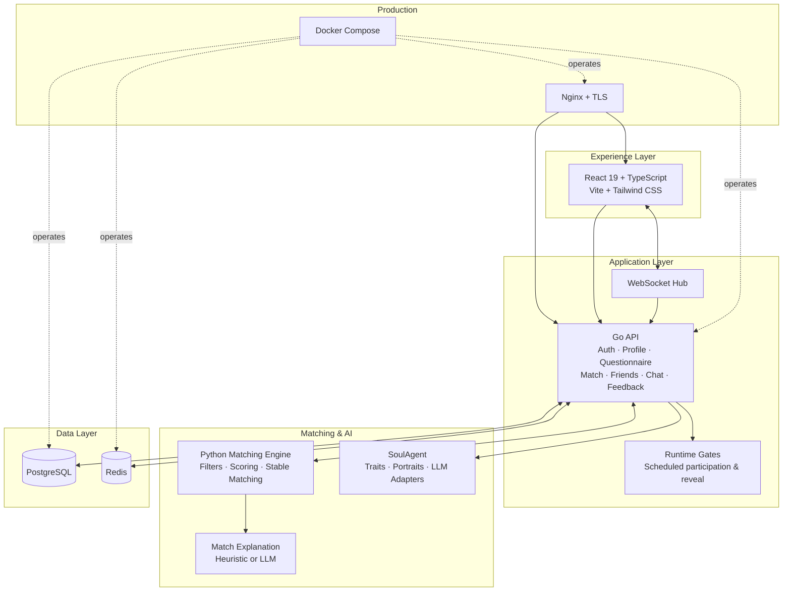
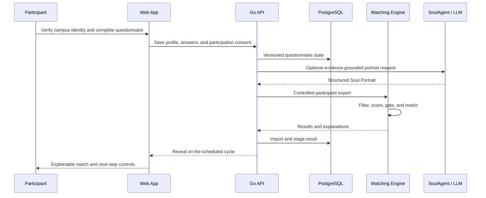

<p align="center">
  
</p>

<h1 align="center">SouLink</h1>

<p align="center">
  <strong>AI-native campus social matching with explainable intelligence and human-centered consent.</strong><br>
  <strong>以可解释智能和真实同意为核心的 AI 原生高校社交匹配平台。</strong>
</p>

<p align="center">
  <a href="https://thusoulink.com/"></a>
  
  
  
  
  
  
  
</p>

<p align="center">
  <a href="./README.md">English</a> ·
  <a href="./README_CN.md">简体中文</a> ·
  <a href="https://thusoulink.com/">Live Product</a> ·
  <a href="#technical-architecture">Architecture</a> ·
  <a href="#matching-intelligence">Matching</a> ·
  <a href="#privacy-by-design">Privacy</a> ·
  <a href="#quick-start">Quick Start</a>
</p>

> [!NOTE]
> SouLink is a deployed, actively maintained product at [thusoulink.com](https://thusoulink.com/). The images in this repository are captures of the production experience, not interface mockups. Product metrics and interfaces may evolve after the documented snapshot date.

## Engineering overview

SouLink is a production-oriented monorepo, not a frontend-only demo. It separates the interactive product, transactional API, controlled matching jobs, optional AI generation, persistent data, and deployment automation into explicit service boundaries.

| Layer | Responsibility | Implementation |
| --- | --- | --- |
| Experience | Campus landing pages, identity, questionnaire, match reveal, friends, chat, feedback | React 19, TypeScript, Vite 8, Tailwind CSS 4 |
| Application | Authentication, profiles, questionnaire versions, runtime gates, match lifecycle, social graph, WebSocket chat | Go 1.26, Chi, JWT, WebSocket |
| Matching | Eligibility, hard constraints, seven-dimensional scoring, quality gates, stable and weighted matching | Python, pandas, NetworkX |
| AI | Evidence-grounded SoulAgent portraits and match explanations with heuristic fallback | Deterministic traits engine, OpenAI-compatible adapters |
| Data | Durable application state, migrations, ephemeral cache and coordination | PostgreSQL 16, Redis 7 |
| Delivery | Reverse proxy, TLS, container packaging, health checks, offline image transfer | Docker Compose, Nginx, Bash |

Engineering principles:

- **Explainability before engagement loops** — every recommendation is tied to questionnaire evidence and visible compatibility dimensions.
- **LLM-optional operation** — deterministic matching and heuristic explanations keep the core system functional without a model provider.
- **Consent as state** — participation, reveal, friendship, and contact exposure are explicit lifecycle transitions.
- **Versioned data contracts** — questionnaire catalogs, answer migrations, database migrations, and match import/export formats are managed artifacts.
- **Operationally deployable** — the repository includes health checks, TLS termination, Compose orchestration, migration commands, and update tooling.

## Product at a glance

- 🧠 **Thoughtful profiles** — go beyond surface-level bios with a structured,
  52-question experience.
- 🎯 **Intentional 1:1 matching** — prioritize match quality over swipe volume
  or forced coverage.
- 🤖 **Explainable AI** — turn questionnaire evidence into Soul Portraits and
  understandable match explanations.
- 🏫 **Campus-native communities** — preserve each university's identity while
  connecting a broader campus alliance.
- 🔐 **Privacy-conscious design** — reveal only the information needed for a
  meaningful, consensual introduction.

## What is SouLink?

SouLink is a full-stack AI social product initiated by a student team from
Tsinghua University. It is built around a simple belief: while technology makes
it easier to see more people, genuinely understanding another person is still
difficult.

Instead of optimizing for more swipes, impressions, or time on screen, SouLink
asks participants to describe themselves carefully, express their boundaries
and expectations, and join a scheduled matching cycle only when they are ready.
The system then combines structured compatibility signals, matching algorithms,
and optional LLM-generated portraits and explanations to create more
intentional introductions.

The current product focuses on university communities and the SouLink Campus
Alliance. The longer-term direction is to explore new **AI + Social** and
**Agent-to-Agent** interaction paradigms while keeping the human relationship—not
the model—at the center.

## Product experience

### 1. Enter through your campus

The alliance experience gives each campus its own entry point and identity.
Participants can choose the university communities they hope to connect with,
while the product maintains one shared matching experience across campuses.


At the time these screenshots were captured on **24 July 2026**, the public
landing page displayed:

- **1,269 total registrations**;
- **14 listed university communities**;
- campus coverage across Beijing, Shanghai, Hubei, Hunan, and Singapore;
- a scheduled weekly result reveal rather than an always-on recommendation feed.

These are live product metrics and will change over time.

### 2. Write, receive, and meet

The product experience is deliberately easy to understand:


1. **Write who you are** — complete a 52-question experience about identity,
   values, lifestyle, boundaries, relationship expectations, and future plans.
2. **Receive one thoughtful delivery** — join a weekly cycle and receive a
   result with context instead of repeatedly swiping through profiles.
3. **Meet the other person** — when both sides are ready, SouLink opens the
   minimum contact path needed for the story to continue offline.

### 3. A campus-native identity

Each campus page can carry its own atmosphere and narrative while using the
same product, matching, and trust infrastructure underneath.

<table>
  <tr>
    <td width="50%">
      
      <br>
      <sub><strong>Campus experience:</strong> a school-specific landing page and community identity.</sub>
    </td>
    <td width="50%">
      
      <br>
      <sub><strong>Trusted onboarding:</strong> campus email, account agreement, and a focused login flow.</sub>
    </td>
  </tr>
</table>

## User journey

| Stage | User experience | Product responsibility |
| --- | --- | --- |
| Identity | Register with a supported campus email | Verify eligibility without creating a public people directory |
| Self-expression | Build a profile and complete the questionnaire | Save progress, validate answers, and explain why data is needed |
| Soul Portrait | Read a structured summary of personal traits | Transform answers into an evidence-grounded portrait; optionally use an LLM |
| Participation | Opt into a weekly matching cycle | Respect consent and allow users to skip a cycle |
| Matching | Receive one high-quality result | Apply filters, compatibility scores, quality gates, and stable matching |
| Explanation | Understand why the match may work | Surface mutual strengths, trade-offs, and confidence without overclaiming |
| Connection | Continue through friends and chat | Reveal only the information necessary for an intentional conversation |
| Feedback | Report issues and share product feedback | Improve reliability, safety, matching quality, and user experience |

## Matching intelligence

SouLink is designed to prefer **quality over forced coverage**. A participant can
remain unmatched when the available candidates do not meet the quality gate.

The matching pipeline:

```text
Questionnaire export
  → eligibility and opt-in checks
  → compatible pool assignment
  → hard constraints
  → seven-dimensional scoring
  → mutual quality and asymmetry gates
  → stable matching / maximum-weight fallback
  → result grading and explanation
  → controlled result import and reveal
```

The seven scoring dimensions cover:

1. relationship intent and life stage;
2. geography and distance;
3. attraction and temperament;
4. lifestyle;
5. interests;
6. intimacy and attachment;
7. future plans.

Users can mark specific answers as more important. The engine then weighs those
signals more heavily for that user, rather than assuming one universal formula
for everyone.

Pool-specific algorithms include:

- **Gale–Shapley** matching for two-sided preference pools;
- **Irving stable-roommate matching** for same-pool pairing;
- **maximum-weight matching** as a quality-oriented fallback;
- hard filters, soft vetoes, minimum-score gates, and asymmetry diagnostics.

See
[`matching/docs/matching_score_design.md`](matching/docs/matching_score_design.md)
for the detailed scoring design.

## AI layer: SoulAgent and match explanations

The repository includes an optional AI layer rather than making LLM output a
hard dependency:

- a deterministic traits engine maps questionnaire evidence into structured
  attributes;
- **SoulAgent** can generate a soul signature, personal portrait, and
  description of an ideal connection;
- match explanations support both heuristic and LLM modes;
- provider adapters support multiple OpenAI-compatible model services;
- prompts explicitly avoid diagnosis, trauma inference, fatalistic claims, and
  conclusions unsupported by the questionnaire.

The current implementation uses AI to improve expression and explainability.
**Agent-to-Agent social interaction is a product and research direction, not a
claim that autonomous agents replace human consent or judgment.**

## Technical architecture



### Repository structure

| Directory | Responsibility | Main technologies |
| --- | --- | --- |
| [`frontend/`](frontend/) | Landing pages, campus experiences, authentication, questionnaire, dashboard, profile, friends, chat, feedback | React 19, TypeScript, Vite 8, Tailwind CSS 4, React Router, Framer Motion |
| [`backend/`](backend/) | APIs, authentication, profiles, questionnaire state, match reveal, friends, chat, feedback, migrations, SoulAgent integration | Go, Chi, PostgreSQL, Redis, JWT, WebSocket |
| [`matching/`](matching/) | Offline/controlled matching runs and explanation generation | Python, pandas, NetworkX, OpenAI-compatible clients |
| [`deploy/`](deploy/) | Full-stack packaging and production operations | Docker Compose, Nginx, TLS, health checks, offline image transfer |

### End-to-end data flow



## Privacy by design

Social matching data deserves a higher standard than ordinary product
analytics. SouLink's product policy and implementation follow these principles:

- profiles are not placed in a public browsing or swipe feed;
- contact details are not exposed before a relevant match and user action;
- the service collects account, questionnaire, essential usage, and technical
  data only for authentication, matching, operation, and improvement;
- passwords are hashed, production traffic is served over TLS, and access is
  mediated by authenticated APIs;
- users can edit their profiles and request account deletion;
- personal data is not sold, rented, or used for third-party advertising;
- Cookie/local storage usage is limited to login state, questionnaire drafts,
  and necessary site preferences;
- no real production user exports, credentials, certificates, or local secret
  configuration are included in this repository.

No online service can promise absolute security. Please do not submit highly
sensitive information unrelated to matching, and report privacy or deletion
requests to [thusoulink@163.com](mailto:thusoulink@163.com).

See [`docs/PRIVACY.md`](docs/PRIVACY.md) for the repository privacy overview.

## Adoption and campus growth

SouLink is exploring a network model rather than a single-campus clone. The
Campus Alliance is intended to preserve local campus identity while enabling a
larger, more diverse matching pool.

Our approach to responsible growth:

- onboard universities through verified campus email domains;
- invite student communities to co-create campus-specific stories and feedback;
- grow matching pools only when product safety and operational capacity can
  support them;
- measure successful, respectful introductions—not just registrations or screen
  time;
- use participant feedback to improve questionnaire clarity, matching quality,
  explanation usefulness, and reveal-day reliability.

Universities and student teams interested in joining the alliance can contact
[thusoulink@163.com](mailto:thusoulink@163.com).

## Maintenance status and roadmap

SouLink is a live product and remains under active development. The team is
maintaining the production experience while continuing to improve:

- onboarding clarity and campus verification;
- questionnaire quality and version migration;
- matching quality, fairness, and explainability;
- Soul Portrait and match-explanation reliability;
- reveal scheduling, observability, and operational recovery;
- privacy controls, account deletion, abuse handling, and data minimization;
- campus alliance tooling and community feedback loops;
- future AI + Social and Agent-to-Agent experiments.

Interfaces, questionnaire versions, and live registration counts may evolve.
The screenshots in this README document the production experience at the date
noted above.

## Verified engineering status

The following checks were executed against this repository on 30 July 2026:

| Surface | Command | Result |
| --- | --- | --- |
| Full local stack | `docker compose up -d --build` | Passed; web, API, PostgreSQL, Redis, and Mailpit containers reached healthy state |
| Web health | `curl http://127.0.0.1:18080/health` | Passed; returned `ok` |
| API through web proxy | `curl http://127.0.0.1:18080/api/v1/meta/registered-user-count` | Passed; returned `registeredUserCount` JSON |
| Frontend lint | `npm run lint` | Passed with warnings for existing React Hooks and Fast Refresh style rules |
| Frontend production bundle | `npm run build` | Passed; Vite compiled `2,368` modules |
| Go backend | `go test ./...` | Passed |
| Python matching modules | `python3 -m compileall matching` | Passed |

> [!NOTE]
> `npm audit` currently reports two high-severity React Router advisories tied
> to RSC/server-action mode. This codebase uses React Router as a Vite SPA and
> does not enable RSC or server actions. The package is pinned to the latest
> available `react-router-dom@7.18.2`; revisit this when a non-vulnerable
> upstream release is available.

## Quick start

### Requirements

- Node.js 20.19+ or 22.12+
- Go 1.26.1+
- Python 3.10+
- Docker and Docker Compose

### Option A: start the full local stack with Docker

```bash
docker compose up -d --build
```

Then open:

- Web product: `http://localhost:18080`
- API health: `http://localhost:18081/healthz`
- Mailpit UI: `http://localhost:8025`

Stop the stack with:

```bash
docker compose down
```

The local Compose file builds both app images and starts PostgreSQL, Redis,
Mailpit, the Go API, and the Nginx-served web app. If Go module downloads are
slow in your network, override the build proxy:

```bash
GOPROXY=https://proxy.golang.org,direct docker compose up -d --build
```

### Option B: run services manually for development

#### 1. Start PostgreSQL, Redis, and local email

```bash
cp backend/.env.example backend/.env
docker compose -f backend/docker-compose.yml up -d postgres redis mailpit
```

PostgreSQL binds to `127.0.0.1:15432`, Redis to `127.0.0.1:16379`, and the Mailpit UI to `http://127.0.0.1:8025`.

#### 2. Start the API

```bash
cd backend
go run ./cmd/api
```

The API listens on `http://localhost:8080`; health is available at
`http://localhost:8080/healthz`.

#### 3. Start the web product

```bash
cd frontend
npm ci
npm run dev
```

Open `http://localhost:5173`. The Vite development proxy forwards API requests
to the local backend.

#### 4. Run the matching engine

```bash
cd matching
python3 -m venv .venv
source .venv/bin/activate
pip install -r requirements.txt

# Place a questionnaire export at data/export.csv.
python run_matching.py \
  --csv data/export.csv \
  --output data/match_results.csv
```

Generate explanations without an external model:

```bash
python generate_match_explanations.py \
  --mode heuristic \
  --matches data/match_results.csv \
  --profiles data/export.csv \
  --output data/match_explanations.csv
```

LLM mode is documented in
[`matching/.env.example`](matching/.env.example).

## Production deployment

The deployment module packages the frontend and API as Docker images and can
upload them to a host without external container-registry access.

```bash
cp deploy/.env.example deploy/.env

# Fill required database and JWT secrets, allowed origins, and optional
# mail / LLM settings before continuing.
DEPLOY_REMOTE_HOST=user@your-host bash deploy/deploy.sh pack
DEPLOY_REMOTE_HOST=user@your-host bash deploy/deploy.sh remote-update
```

The production host must provide TLS files at:

```text
/root/ssl/cert.pem
/root/ssl/key.pem
```

Run `bash deploy/deploy.sh` to see packaging, setup, update, status, log,
restart, and stop commands.

## Security and repository hygiene

Before this repository was published:

- all reachable Git history was scanned for credentials and routable IP
  addresses;
- committed `.env`, local import configuration, SMTP credentials, server
  addresses, and community QR codes were removed or sanitized;
- safe example configuration was recreated with empty/non-secret values;
- all original branches and tags were retained under namespaced refs.

History rewriting is not credential revocation. Any credential that existed in a
private source repository should still be rotated at its provider.

## Repository history

This monorepo preserves the development history of four original SouLink
repositories. Original author names, author dates, commit dates, and messages
are retained; one generated revert reference was updated to its rewritten
commit ID. Commit hashes changed because files moved into module directories
and sensitive material was removed.

See [`docs/MIGRATION.md`](docs/MIGRATION.md) for source mappings, branch/tag
layout, commit counts, and the sanitation record.

## Our story


SouLink did not begin as an attempt to build another campus dating clone. It
began from the observation that modern interfaces make it easy to notice one
another but often encourage shallow, hurried judgments. The team believes that
valuable relationships require people to express themselves seriously,
understand one another with care, and treat each introduction as meaningful.

The project was initiated by a student team from Tsinghua University spanning
multiple academic backgrounds. We are exploring how AI can support deeper
understanding, resonance, and sincerity—not how it can automate away the human
part of a relationship.


The Campus Alliance reflects a second belief: the social imagination of an
AI-native generation should not stop at one university gate. Different campuses
have different cultures and stories, but young people also share a common
technological moment. SouLink aims to connect those communities openly and
responsibly, and to co-create a more sincere AI-native social paradigm.

**Let AI serve sincerity, and let connection return to reality.**

---

For product feedback, campus collaboration, privacy requests, or team
inquiries: [thusoulink@163.com](mailto:thusoulink@163.com).
