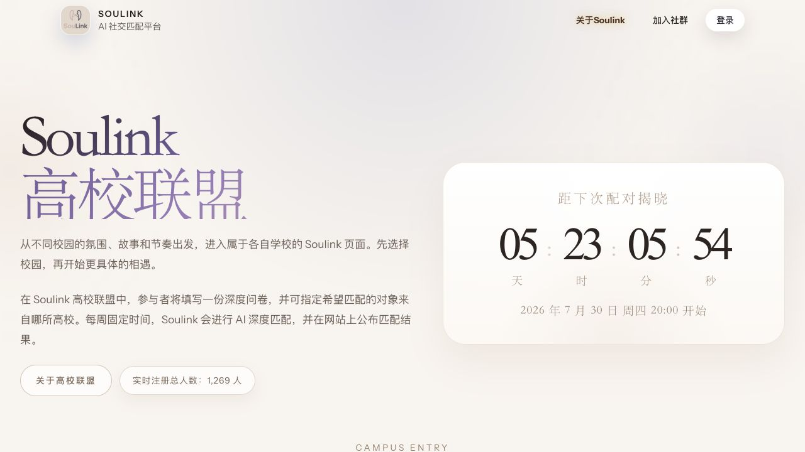
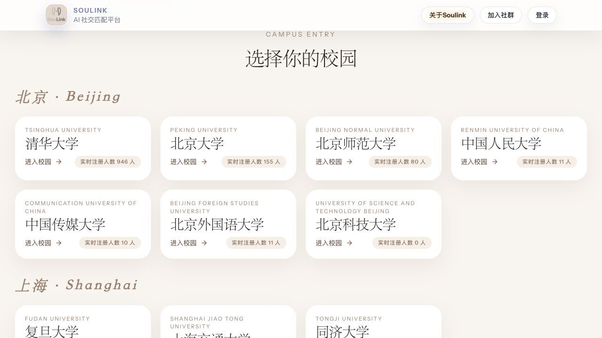
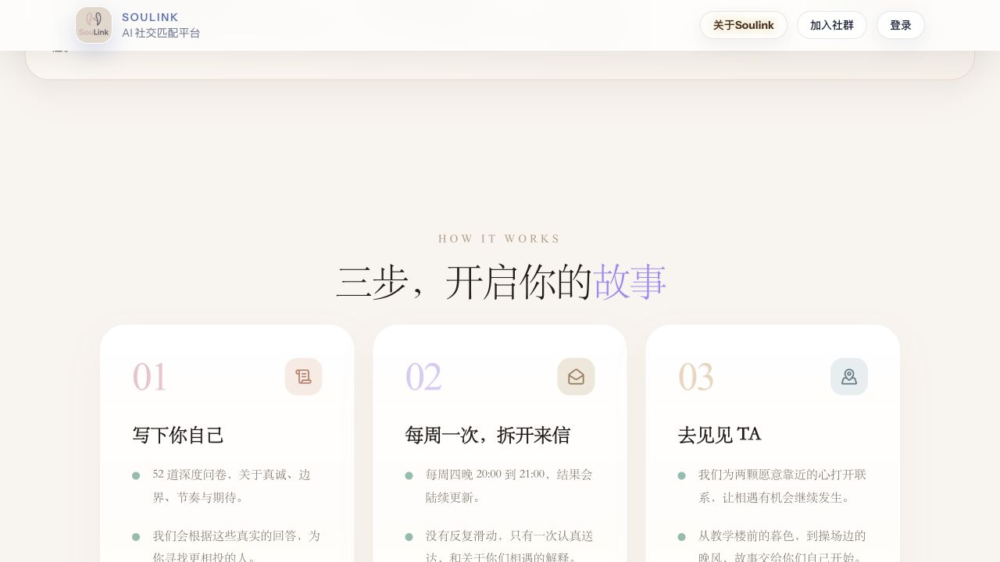
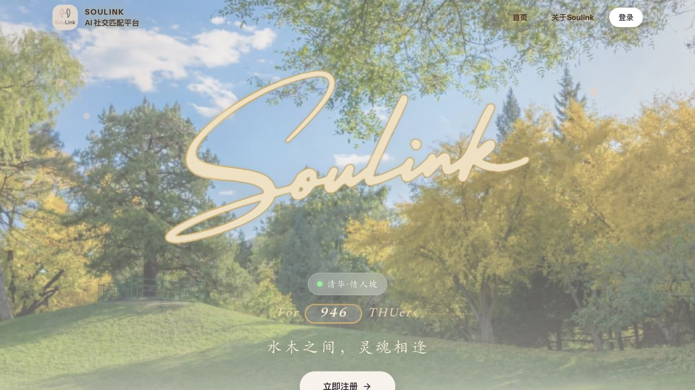
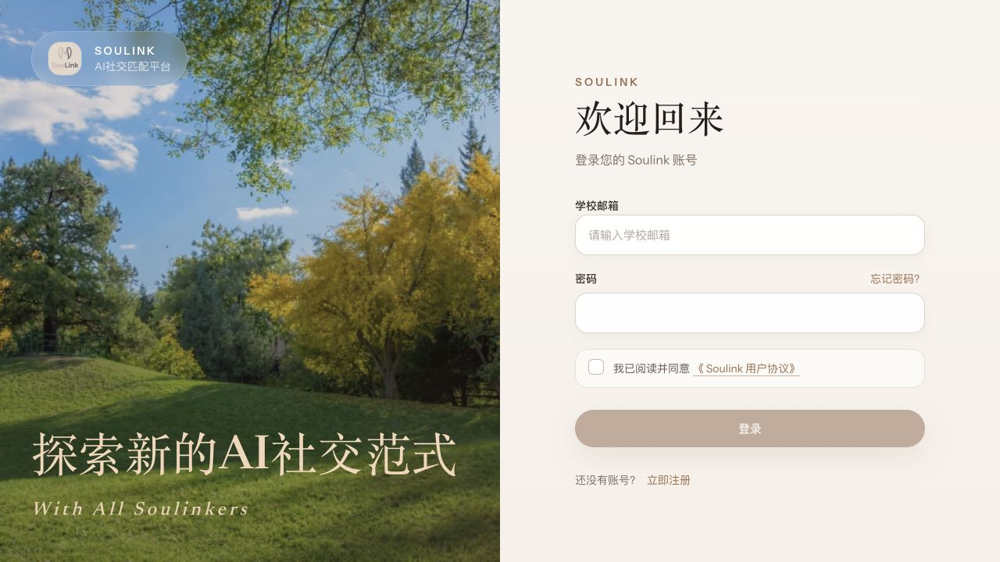
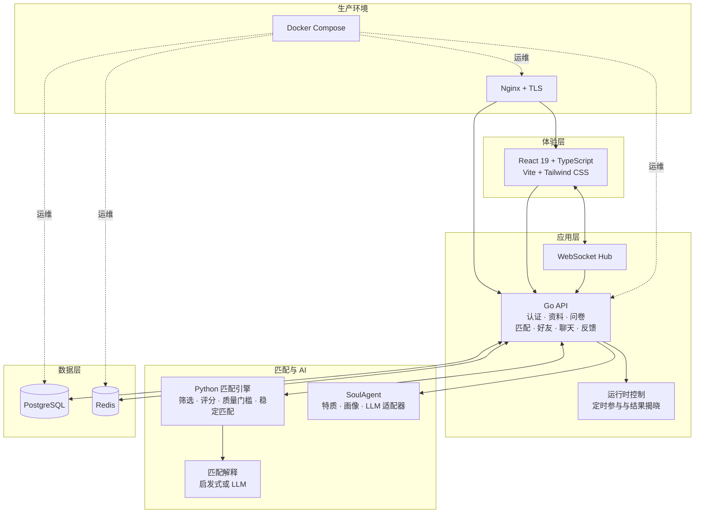
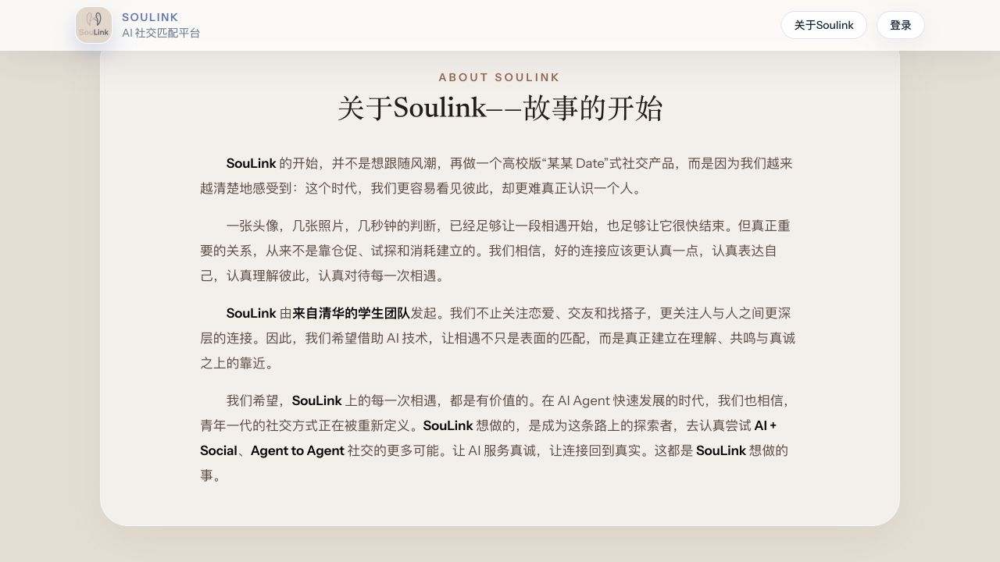
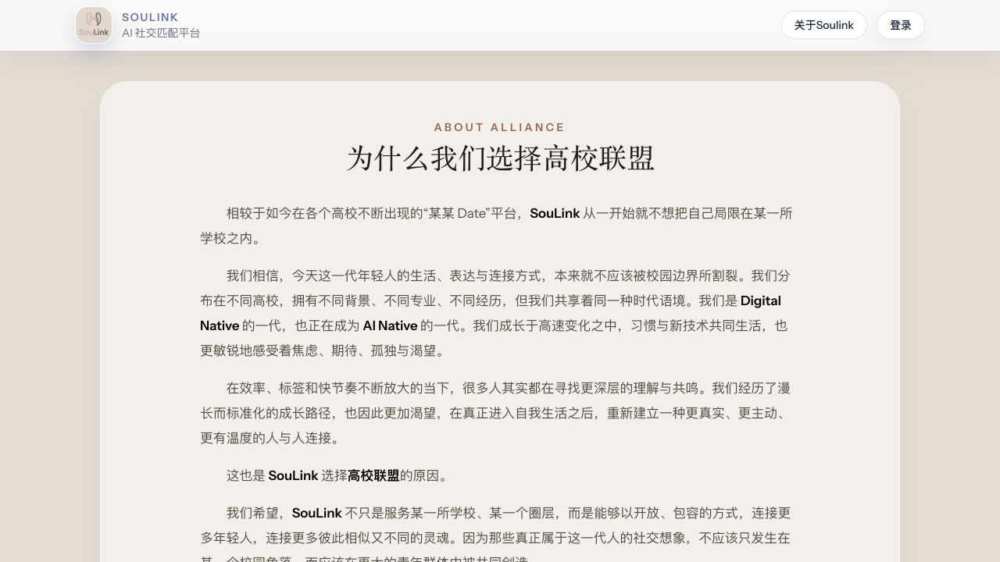

<p align="center">
  
</p>

<h1 align="center">SouLink</h1>

<p align="center">
  <strong>以可解释智能和真实同意为核心的 AI 原生高校社交匹配平台。</strong><br>
  <strong>AI-native campus social matching with explainable intelligence and human-centered consent.</strong>
</p>

<p align="center">
  <a href="https://thusoulink.com/"></a>
  
  
  
  
  
  
  
</p>

<p align="center">
  <a href="./README.md">English</a> ·
  <a href="./README_CN.md">简体中文</a> ·
  <a href="https://thusoulink.com/">在线产品</a> ·
  <a href="#技术架构">技术架构</a> ·
  <a href="#匹配智能">匹配引擎</a> ·
  <a href="#隐私设计">隐私</a> ·
  <a href="#快速开始">快速开始</a>
</p>

> [!NOTE]
> SouLink 已部署并持续运行于 [thusoulink.com](https://thusoulink.com/)。仓库中的界面图片来自真实线上产品，而非设计稿。产品数据与界面可能在截图记录日期后继续变化。

## 工程概览

SouLink 是一个面向生产环境的 Monorepo，而不是单纯的前端 Demo。交互产品、事务 API、受控匹配任务、可选 AI 生成、持久化数据与部署自动化均拥有清晰的服务边界。

| 层级 | 职责 | 实现 |
| --- | --- | --- |
| 体验层 | 高校落地页、身份认证、问卷、匹配揭晓、好友、聊天、反馈 | React 19、TypeScript、Vite 8、Tailwind CSS 4 |
| 应用层 | 认证、资料、问卷版本、运行时 Gate、匹配生命周期、社交关系、WebSocket 聊天 | Go 1.26、Chi、JWT、WebSocket |
| 匹配层 | 资格判断、硬约束、七维评分、质量门槛、稳定匹配与最大权重匹配 | Python、pandas、NetworkX |
| AI 层 | 基于证据的 SoulAgent 画像与匹配解释，支持启发式降级 | 确定性特质引擎、OpenAI-compatible 适配器 |
| 数据层 | 持久化业务状态、数据库迁移、临时缓存与协调 | PostgreSQL 16、Redis 7 |
| 交付层 | 反向代理、TLS、容器打包、健康检查、离线镜像传输 | Docker Compose、Nginx、Bash |

工程原则：

- **可解释性优先于推荐上瘾机制**：每个结果都对应问卷证据和可见的兼容维度。
- **LLM 不是硬依赖**：确定性匹配与启发式解释保证没有模型服务时核心流程仍可运行。
- **将同意建模为状态**：参与、揭晓、好友关系和联系方式展示都是明确的生命周期转换。
- **版本化数据契约**：问卷目录、答案迁移、数据库迁移和匹配导入导出格式均作为受管理的工程资产。
- **可实际部署**：仓库包含健康检查、TLS 终止、Compose 编排、迁移命令和更新工具。

## 产品亮点

- 🧠 **深度自我表达** — 通过 52 道结构化问题，呈现比普通个人简介更完整的自己。
- 🎯 **高质量一对一匹配** — 关注匹配质量，而不是滑动数量或强行提高匹配覆盖率。
- 🤖 **可解释的 AI** — 基于问卷证据生成 Soul Portrait，并给出易于理解的匹配说明。
- 🏫 **高校原生社区** — 保留每所学校的独特氛围，同时连接更广泛的高校联盟。
- 🔐 **隐私优先** — 只在合适、双方知情的连接场景中展示必要信息。

## 什么是 SouLink？

SouLink 是由清华大学学生团队发起的全栈 AI 社交产品。我们相信：
科技让人们更容易看见彼此，但真正理解一个人，依然很难。

SouLink 不追求更多滑动、更多曝光或更长的停留时间。参与者可以认真描述自己，
表达边界与期待，并在准备好后自愿加入定期匹配。系统将结构化的兼容性信号、
匹配算法，以及可选的 LLM 画像与解释能力结合起来，促成更有质量的相遇。

当前产品以高校社区和 SouLink 高校联盟为核心。长期来看，我们希望在始终尊重
真实关系与个人意愿的前提下，探索新的 **AI + Social** 与
**Agent-to-Agent** 交互范式。

## 产品体验

### 1. 从你的校园进入

高校联盟为不同学校提供独立入口与校园身份。用户可以选择希望连接的高校社区，
同时在统一的产品、匹配与信任体系中完成体验。



在这些截图采集时（**2026 年 7 月 24 日**），公开首页展示了：

- **1,269 名注册用户**；
- **14 个高校社区**；
- 覆盖北京、上海、湖北、湖南和新加坡；
- 按周揭晓的匹配机制，而不是持续刷新的推荐信息流。

以上是当时的真实线上数据，后续会随产品运营持续变化。

### 2. 写下、收到、见面

SouLink 的核心体验简单而清晰：



1. **写下你是谁** — 完成包含身份、价值观、生活方式、边界、关系期待与未来规划的
   52 道深度问卷。
2. **收到一份认真准备的投递** — 加入每周匹配，在上下文充分的情况下获得结果，
   而不是反复滑动大量资料。
3. **见到对方** — 当双方都准备好后，SouLink 提供继续在线下展开故事所需的最小联系路径。

### 3. 高校原生的身份体验

每所学校都可以保留自己的氛围与叙事，同时共享底层产品、匹配和信任基础设施。

<table>
  <tr>
    <td width="50%">
      
      <br>
      <sub><strong>校园体验：</strong>具有学校特色的落地页与社区身份。</sub>
    </td>
    <td width="50%">
      
      <br>
      <sub><strong>可信加入：</strong>校园邮箱、账户协议和专注清晰的登录流程。</sub>
    </td>
  </tr>
</table>

## 用户旅程

| 阶段 | 用户体验 | 产品责任 |
| --- | --- | --- |
| 身份验证 | 使用支持的校园邮箱注册 | 验证高校身份，同时不建立公开人员目录 |
| 自我表达 | 完善资料并完成问卷 | 保存进度、校验答案，并解释数据用途 |
| 灵魂画像 | 阅读结构化的个人特质总结 | 基于证据生成画像，并可选择使用 LLM |
| 参与匹配 | 自愿加入每周匹配周期 | 尊重个人意愿，并允许用户跳过某一期 |
| 智能匹配 | 获得一个高质量结果 | 应用筛选、兼容性评分、质量门槛与稳定匹配 |
| 结果解释 | 理解双方可能契合的原因 | 呈现优势、差异与置信度，避免过度承诺 |
| 建立连接 | 通过好友与聊天继续交流 | 仅展示开启真诚对话所需的信息 |
| 反馈改进 | 报告问题并提交产品反馈 | 改进安全性、稳定性、匹配质量和用户体验 |

## 匹配智能

SouLink 坚持 **质量优先于强制覆盖**。当候选人未达到质量门槛时，参与者可以暂不匹配。

匹配流程如下：

```text
问卷数据导出
  → 资格与参与意愿检查
  → 兼容候选池分配
  → 硬性约束过滤
  → 七维兼容性评分
  → 双向质量与不对称门槛
  → 稳定匹配 / 最大权重匹配兜底
  → 结果分级与解释生成
  → 受控导入并定时揭晓
```

七个评分维度包括：

1. 关系意愿与人生阶段；
2. 地理位置与距离；
3. 吸引力与性格倾向；
4. 生活方式；
5. 兴趣爱好；
6. 亲密关系与依恋；
7. 未来规划。

用户可以将某些回答标记为更加重要。引擎会针对该用户提高相应信号权重，
而不是假定所有人都适用同一套公式。

不同匹配池会使用：

- 面向双边偏好池的 **Gale–Shapley 稳定匹配**；
- 面向同类候选池的 **Irving 稳定室友算法**；
- 以整体质量为导向的 **最大权重匹配**；
- 硬性筛选、软性否决、最低分门槛与不对称诊断。

完整评分设计见
[`matching/docs/matching_score_design.md`](matching/docs/matching_score_design.md)。

## AI 层：SoulAgent 与匹配解释

LLM 是 SouLink 的可选增强能力，而不是产品正常运行的硬性依赖：

- 确定性的特质引擎将问卷证据映射为结构化属性；
- **SoulAgent** 可以生成灵魂签名、个人画像和理想连接描述；
- 匹配解释同时支持启发式模式与 LLM 模式；
- 模型适配器兼容多个 OpenAI-compatible 服务；
- 提示词明确避免诊断、创伤推断、宿命式判断，以及问卷证据无法支持的结论。

当前 AI 能力用于提升表达与可解释性。**Agent-to-Agent 社交是一项产品和研究方向，
并不意味着由自主智能体取代人的同意或判断。**

## 技术架构



### 仓库结构

| 目录 | 职责 | 主要技术 |
| --- | --- | --- |
| [`frontend/`](frontend/) | 首页、校园体验、认证、问卷、工作台、资料、好友、聊天与反馈 | React 19、TypeScript、Vite 8、Tailwind CSS 4、React Router、Framer Motion |
| [`backend/`](backend/) | API、认证、资料、问卷状态、结果揭晓、好友、聊天、反馈、迁移与 SoulAgent 集成 | Go、Chi、PostgreSQL、Redis、JWT、WebSocket |
| [`matching/`](matching/) | 离线或受控匹配任务与解释生成 | Python、pandas、NetworkX、OpenAI-compatible clients |
| [`deploy/`](deploy/) | 全栈打包与生产运维 | Docker Compose、Nginx、TLS、健康检查、离线镜像传输 |

## 隐私设计

社交匹配数据理应获得比普通产品分析数据更高标准的保护：

- 用户资料不会进入公开浏览或滑动信息流；
- 在匹配成立并经过相关用户操作前，不公开联系方式；
- 仅为认证、匹配、运行与改进收集必要的账户、问卷、使用及技术数据；
- 密码经过哈希处理，生产流量使用 TLS，并通过已认证 API 访问；
- 用户可以编辑资料并申请注销账户；
- 不出售、出租个人数据，也不用于第三方广告；
- Cookie 与本地存储仅用于登录状态、问卷草稿和必要的网站偏好；
- 本仓库不包含真实生产用户导出、凭据、证书或本地私密配置。

任何在线服务都无法承诺绝对安全。请勿提交与匹配无关的高度敏感信息。
隐私或注销请求可发送至 [thusoulink@163.com](mailto:thusoulink@163.com)。

更多信息见 [`docs/PRIVACY.md`](docs/PRIVACY.md)。

## 高校联盟与增长

SouLink 希望构建一个高校网络，而不是简单复制单校产品。高校联盟既保留本地校园身份，
也让参与者有机会进入更大、更多元的匹配池。

我们的增长原则：

- 通过经过验证的校园邮箱域名接入高校；
- 邀请学生社区共同创造校园故事并持续反馈；
- 只在产品安全与运营能力足以支撑时扩大匹配池；
- 衡量有质量、相互尊重的连接，而不只关注注册量或屏幕停留时长；
- 利用用户反馈改进问卷清晰度、匹配质量、解释价值与揭晓日稳定性。

有兴趣加入高校联盟的学校与学生团队，欢迎联系
[thusoulink@163.com](mailto:thusoulink@163.com)。

## 维护状态与路线图

SouLink 是持续运行并积极维护的产品。团队目前重点改进：

- 新用户引导与校园验证；
- 问卷质量与版本迁移；
- 匹配质量、公平性与可解释性；
- 灵魂画像和匹配解释的稳定性；
- 结果揭晓调度、可观测性与故障恢复；
- 隐私控制、账户注销、滥用处理与数据最小化；
- 高校联盟工具与社区反馈闭环；
- 未来的 AI + Social 与 Agent-to-Agent 实验。

界面、问卷版本和实时注册数量会随产品迭代而变化。本 README 中的截图记录的是标注日期的线上体验。

## 已验证的工程状态

以下检查已于 2026 年 7 月 30 日在本仓库执行：

| 范围 | 命令 | 结果 |
| --- | --- | --- |
| 本地全栈 | `docker compose up -d --build` | 通过；Web、API、PostgreSQL、Redis 与 Mailpit 容器均进入 healthy 状态 |
| Web 健康检查 | `curl http://127.0.0.1:18080/health` | 通过；返回 `ok` |
| Web 反代 API | `curl http://127.0.0.1:18080/api/v1/meta/registered-user-count` | 通过；返回 `registeredUserCount` JSON |
| 前端 Lint | `npm run lint` | 通过；仍保留 React Hooks 与 Fast Refresh 风格规则 warning |
| 前端生产构建 | `npm run build` | 通过；Vite 完成 `2,368` 个模块编译 |
| Go 后端 | `go test ./...` | 通过 |
| Python 匹配模块 | `python3 -m compileall matching` | 通过 |

> [!NOTE]
> `npm audit` 当前仍报告两个 React Router 高危 advisory，触发点与
> RSC/server-action 模式有关。本代码库将 React Router 用作 Vite SPA，
> 不启用 RSC 或 server actions。依赖已固定到当前可用的最新版
> `react-router-dom@7.18.2`，后续可在上游发布无漏洞版本后继续升级。

## 快速开始

### 环境要求

- Node.js 20.19+ 或 22.12+
- Go 1.26.1+
- Python 3.10+
- Docker 与 Docker Compose

### 方式 A：用 Docker 启动完整本地栈

```bash
docker compose up -d --build
```

启动后访问：

- Web 产品：`http://localhost:18080`
- API 健康检查：`http://localhost:18081/healthz`
- Mailpit 邮件界面：`http://localhost:8025`

停止本地栈：

```bash
docker compose down
```

本地 Compose 会构建前后端镜像，并启动 PostgreSQL、Redis、Mailpit、Go API
与 Nginx 承载的 Web 应用。如果当前网络下载 Go 模块较慢，可以覆盖构建代理：

```bash
GOPROXY=https://proxy.golang.org,direct docker compose up -d --build
```

### 方式 B：手动启动开发环境

#### 1. 启动 PostgreSQL、Redis 与本地邮件服务

```bash
cp backend/.env.example backend/.env
docker compose -f backend/docker-compose.yml up -d postgres redis mailpit
```

PostgreSQL 绑定到 `127.0.0.1:15432`，Redis 绑定到 `127.0.0.1:16379`，Mailpit 界面位于 `http://127.0.0.1:8025`。

#### 2. 启动 API

```bash
cd backend
go run ./cmd/api
```

API 默认监听 `http://localhost:8080`，健康检查地址为
`http://localhost:8080/healthz`。

#### 3. 启动 Web 产品

```bash
cd frontend
npm ci
npm run dev
```

打开 `http://localhost:5173`。Vite 开发代理会将 API 请求转发到本地后端。

#### 4. 运行匹配引擎

```bash
cd matching
python3 -m venv .venv
source .venv/bin/activate
pip install -r requirements.txt

# 将问卷导出文件放在 data/export.csv。
python run_matching.py \
  --csv data/export.csv \
  --output data/match_results.csv
```

无需外部模型即可生成启发式解释：

```bash
python generate_match_explanations.py \
  --mode heuristic \
  --matches data/match_results.csv \
  --profiles data/export.csv \
  --output data/match_explanations.csv
```

LLM 模式配置见 [`matching/.env.example`](matching/.env.example)。

## 生产部署

部署模块会将前端与 API 打包为 Docker 镜像，也支持在不依赖外部容器镜像仓库的情况下上传到服务器。

```bash
cp deploy/.env.example deploy/.env

# 继续前请填写必要的数据库与 JWT 密钥、允许来源，
# 以及可选的邮件与 LLM 配置。
DEPLOY_REMOTE_HOST=user@your-host bash deploy/deploy.sh pack
DEPLOY_REMOTE_HOST=user@your-host bash deploy/deploy.sh remote-update
```

运行 `bash deploy/deploy.sh` 可查看打包、初始化、更新、状态、日志、重启与停止命令。

## 安全与仓库治理

在公开本仓库前，我们完成了以下处理：

- 扫描全部可达 Git 历史中的凭据和可路由 IP 地址；
- 删除或清理已提交的 `.env`、本地导入配置、SMTP 凭据、服务器地址和社群二维码；
- 使用空值或非敏感值重新创建安全的示例配置；
- 将原有分支和标签完整保存在命名空间引用中。

重写历史不能替代吊销凭据。任何曾出现在私有源仓库中的凭据都仍应在对应服务商处轮换。

## 仓库历史

该 Monorepo 保留了四个原始 SouLink 仓库的开发历史，包括原作者、作者时间、
提交时间与提交信息。由于文件被移动到模块目录并清除了敏感内容，提交哈希会发生变化。

源仓库映射、分支与标签布局、提交数量及清理记录见
[`docs/MIGRATION.md`](docs/MIGRATION.md)。

## 我们的故事



SouLink 并不是从“再做一个校园恋爱产品”开始的。我们观察到，现代界面让人们更容易
注意到彼此，却也容易鼓励浅薄而匆忙的判断。我们相信，有价值的关系需要认真表达自己、
用心理解他人，并尊重每一次相遇。

项目由来自不同学科背景的清华大学学生团队发起。我们探索的是 AI 如何帮助人们获得
更深的理解、共鸣与真诚，而不是让技术取代关系中属于人的部分。



高校联盟体现了我们的另一个信念：AI 原生一代的社交想象力不应该止步于一所大学的校门。
不同校园拥有不同文化与故事，但年轻人也处在共同的技术时代。SouLink 希望以开放且负责任
的方式连接这些社区，共同创造一种更真诚的 AI 原生社交范式。

**让 AI 服务真诚，让连接回归现实。**

---

产品反馈、高校合作、隐私请求或团队咨询，请联系：
[thusoulink@163.com](mailto:thusoulink@163.com)。
